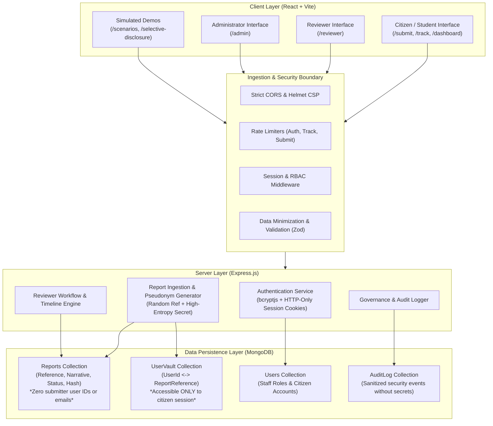
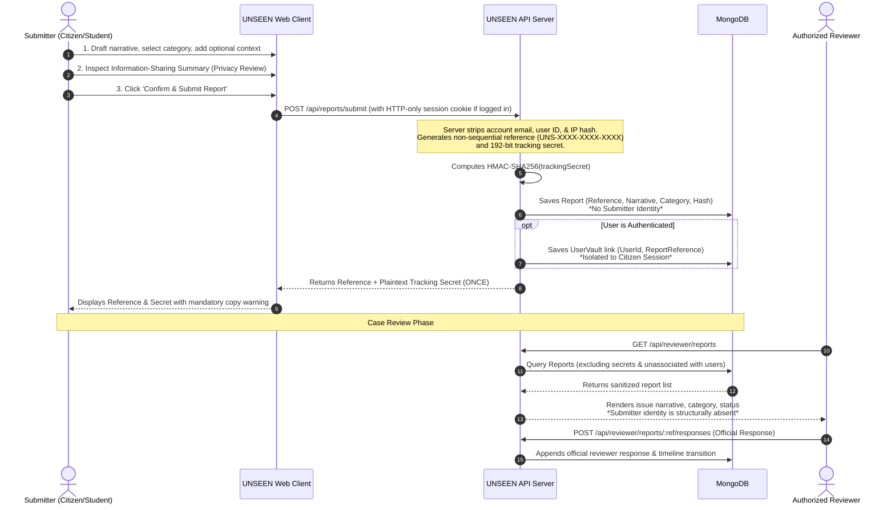

# UNSEEN — System Architecture & Component Design

## 1. System Overview

**UNSEEN** is a privacy-first web platform engineered for confidential problem reporting. It enables authenticated and unauthenticated individuals to report workplace bias, academic retaliation, administrative delays, and privacy concerns without exposing their personal identity to case reviewers or administrative staff.

The system is architected around the core principle: **Authentication $\neq$ Identity Disclosure**. While users can authenticate to manage their cases in a personal vault, their personal account attributes (such as email, user ID, and network metadata) are structurally decoupled from reports stored in the database.

---

## 2. Architecture Diagram

---

## 3. Data Flow Diagram (Submission to Review)

---

## 4. Key Architectural Decisions

### 4.1 Strict Schema Isolation
- The `Report` Mongoose schema does **not** declare fields for `userId`, `email`, `submitterName`, or `ipAddress`.
- This ensures that accidental database projections or blanket `find()` queries can never expose submitter identity, as the data simply does not reside on the document.

### 4.2 High-Entropy Tracking Secrets
- Reports can be tracked anonymously via `POST /api/reports/track`.
- The server stores only the HMAC-SHA256 digest of the secret (`trackingSecretHash`).
- The plaintext secret is never logged, never returned in reviewer queries, and possession of the public reference code alone is strictly rejected with HTTP 400/401.

### 4.3 Authenticated Private Vault
- To allow users to view their submitted cases across sessions, authenticated submissions record an entry in `UserVault` (`userId`, `reportReference`).
- The `UserVault` collection is only queried by `GET /api/reports/my-reports` scoped to `req.user._id`.
- Reviewers and platform administrators have no routes, controllers, or database joins that touch `UserVault`.
